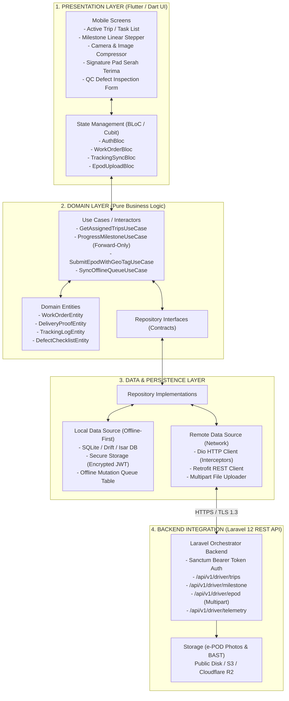
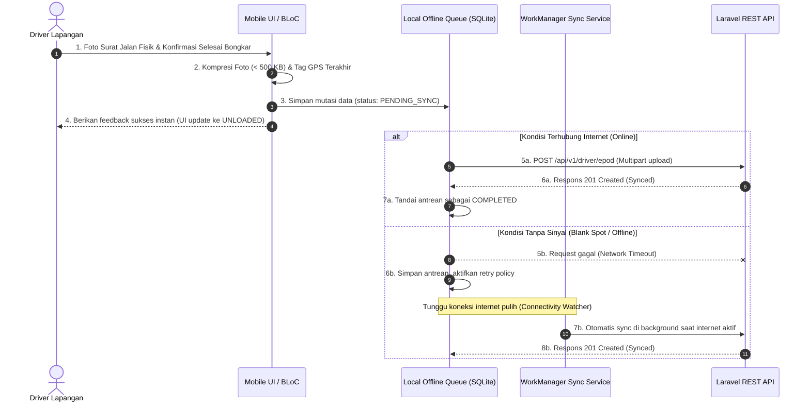

# Arsitektur Aplikasi Mobile: Ekspedisi & Logistik B2B
## PT Dwi Ravi Ladang Energi (Field & Driver Operations)

Dokumen ini mendefinisikan arsitektur sistem perangkat bergerak (*Mobile Architecture*) yang terintegrasi secara *real-time* dengan backend orkestrator **Laravel 12 / MySQL** yang telah dibangun. Arsitektur ini dirancang khusus untuk mengakomodasi kebutuhan lapangan di wilayah operasional kepulauan (Kabupaten Natuna dan rute lintas armada), dengan keandalan tinggi pada kondisi sinyal seluler yang fluktuatif (*offline-first*).

---

## 1. Diagram Arsitektur Tingkat Tinggi (High-Level Mobile Architecture)

Arsitektur aplikasi mobile mengadopsi standar **Clean Architecture** berlapis tiga (*Presentation, Domain, Data*) dengan pola *Offline-First Local Storage Engine*:



---

## 2. Pilihan Tech Stack Rekomendasi

| Komponen | Pilihan Teknologi | Alasan Pemilihan & Relevansi Akademik |
| :--- | :--- | :--- |
| **Framework** | **Flutter (Dart 3.x)** | Standar industri untuk aplikasi cross-platform performa tinggi (60/120 FPS *native rendering engine*), manajemen memori efisien untuk rendering kamera & peta. |
| **Pola Arsitektur** | **Clean Architecture (Uncle Bob)** | Memisahkan kode logika bisnis secara tegas dari antarmuka UI dan driver basis data, sehingga mudah diuji (*unit testing*) dan *maintainable*. |
| **State Management** | **flutter_bloc (BLoC Pattern)** | Menjamin aliran data yang reaktif, searah (*unidirectional data flow*), mudah dilacak status transisi *state* (`Initial`, `Loading`, `Success`, `Error`). |
| **Network Client** | **Dio + Retrofit** | Mendukung *HTTP Interceptors* untuk *auto-attach* token Sanctum, penanganan *refresh token*, serta pemantauan *upload progress* foto e-POD. |
| **Local Database** | **Drift (SQLite) / Hive** | Basis data lokal relasional berkecepatan tinggi untuk menyimpan *cache* tugas pengiriman dan antrean perubahan status (*Offline Mutation Queue*). |
| **Hardware Access** | `camera`, `image_picker`, `geolocator`, `signature` | Akses native hardware Android/iOS untuk foto Surat Jalan, kompresi gambar on-device, penandaan koordinat lintang-bujur GPS, dan tanda tangan digital. |

---

## 3. Strategi Ketahanan Offline-First (Offline Sync Engine)

Kondisi kepulauan dan rute ekspedisi sering kali melintasi wilayah tanpa sinyal seluler (*blank spot*). Aplikasi mobile dirancang dengan prinsip **Zero Failure on Low Network**:



### Aturan Utama Sinkronisasi:
1. **Idempotency Key**: Setiap transaksi status dan upload e-POD diberi UUID unik di sisi HP agar backend tidak menduplikasi data ketika terjadi percobaan ulang pengiriman (*retry*).
2. **Kompresi Gambar On-Device**: Foto beresolusi tinggi dari kamera (3–8 MB) otomatis dikompresi menjadi format JPEG berkualitas 80% dengan batas lebar maksimal 1280px (< 450 KB) sebelum masuk ke antrean kirim untuk menghemat kuota dan mempercepat pengunggahan.

---

## 4. Struktur Modul & Fitur Aplikasi Mobile

```
lib/
├── core/
│   ├── constants/             # API Endpoints, App Colors, Asset Paths
│   ├── errors/                # Failure & Exception classes
│   ├── network/               # Dio Client, Auth Interceptors, Network Info
│   ├── services/              # LocationService, CameraService, CompressionService
│   └── utils/                 # CurrencyFormatter, DateFormatter
├── features/
│   ├── auth/                  # Modul Autentikasi Pengemudi / Akun Lapangan
│   │   ├── data/              # AuthRemoteDataSource, AuthRepositoryImpl
│   │   ├── domain/            # LoginUseCase, AuthEntity
│   │   └── presentation/      # LoginScreen, PinCodeScreen, AuthBloc
│   ├── work_orders/           # Modul Daftar Tugas & Perjalanan Aktif
│   │   ├── data/              # WorkOrderLocalDataSource, WorkOrderRepository
│   │   ├── domain/            # GetTripsUseCase, WorkOrderEntity
│   │   └── presentation/      # TripListScreen, TripDetailScreen, WorkOrderBloc
│   ├── tracking_milestones/   # Modul Pembaruan Status Searah (Forward-Only)
│   │   ├── domain/            # UpdateMilestoneUseCase
│   │   └── presentation/      # LinearStepTimelineWidget, StatusUpdateModal
│   ├── epod_inspection/       # Modul Serah Terima e-POD & Lembar Cacat Barang
│   │   ├── data/              # EpodSyncQueueTable, EpodRemoteUploader
│   │   ├── domain/            # SubmitEpodUseCase, DefectInspectionEntity
│   │   └── presentation/      # EpodCameraScreen, SignaturePadScreen, DefectChecklistScreen
└── main.dart                  # Entry Point & Dependency Injection (GetIt)
```

---

## 5. Spesifikasi Kontrak RESTful API (Integrasi Laravel Backend)

Backend Laravel mengekspos rute terproteksi API Token (`auth:sanctum`):

### A. Autentikasi Driver
- **Endpoint**: `POST /api/v1/auth/login-driver`
- **Request Body**:
  ```json
  {
    "phone_number": "081234567890",
    "pin": "123456"
  }
  ```
- **Response (200 OK)**:
  ```json
  {
    "success": true,
    "token": "1|xyzSecureSanctumBearerToken...",
    "driver": {
      "id": 14,
      "name": "Budi Santoso",
      "phone": "081234567890",
      "transporter": "PT Natuna Angkutan Mandiri"
    }
  }
  ```

### B. Mengambil Daftar Tugas Aktif (Work Orders)
- **Endpoint**: `GET /api/v1/driver/work-orders`
- **Headers**: `Authorization: Bearer <token>`
- **Response (200 OK)**:
  ```json
  {
    "data": [
      {
        "wo_number": "WO-202610-A9128",
        "qr_code_hash": "a1b2c3d4e5f6...",
        "delivery_note_number": "SJ/202610/0042",
        "current_status": "ON_THE_WAY",
        "origin": {
          "facility": "Depo LPG Ranai",
          "address": "Jl. Ali Murtopo, Ranai Kota",
          "loading_date": "2026-11-20 08:30:00"
        },
        "destination": {
          "facility": "Pangkalan Gas Bunguran Barat",
          "address": "Sedanau, Bunguran Barat",
          "unloading_date": "2026-11-20 16:00:00"
        },
        "items": [
          {"name": "Tabung LPG 3kg Isi", "quantity": 560, "unit": "Tabung"},
          {"name": "Tabung LPG 12kg Kosong", "quantity": 40, "unit": "Tabung"}
        ]
      }
    ]
  }
  ```

### C. Pembaruan Milestone Pengiriman (Forward-Only)
- **Endpoint**: `POST /api/v1/driver/work-orders/{hash}/milestone`
- **Request Body**:
  ```json
  {
    "status": "AT_DESTINATION",
    "latitude": 3.945210,
    "longitude": 108.389140,
    "notes": "Armada telah tiba di gerbang gudang penerima"
  }
  ```

### D. Pengunggahan Bukti e-POD & Lembar Cek Cacat
- **Endpoint**: `POST /api/v1/driver/work-orders/{hash}/epod`
- **Content-Type**: `multipart/form-data`
- **Form Fields**:
  - `recipient_name`: Nama PIC penerima di gudang.
  - `epod_image`: Berkas foto Surat Jalan fisik yang telah dicap & ditandatangani.
  - `cargo_photo`: Foto fisik kargo saat selesai dibongkar.
  - `signature_svg_base64`: (Opsional) Tanda tangan digital penerima di layar HP.
  - `has_discrepancy`: `0` atau `1`.
  - `defects`: JSON string checklist cacat (bocor, penyok, karat, rusak).

---

## 6. Fitur Unggulan Mobile untuk Operasional Lapangan

1. **Scanner Surat Jalan Cepat (QR Code)**:
   Driver cukup mengarahkan kamera HP ke QR Code yang tercetak di sudut atas lembar Surat Jalan resmi untuk langsung membuka detail tugas pengiriman tanpa perlu mengetik nomor DO.
2. **QC Cek Cacat Barang Interaktif (Halaman 2 Surat Jalan)**:
   Di lokasi muat/bongkar, driver dapat mencentang kondisi tabung gas LPG (bocor, penyok, valve rusak, karat parah) dan langsung mengambil foto kerusakan sebagai bukti sanggah klaim.
3. **Background GPS Telemetry**:
   Setiap 15 menit sekali selama status armada berada dalam `ON_THE_WAY`, modul latar belakang mengirimkan koordinat GPS ke server untuk mengupdate lokasi di portal pemantauan klien (*Client Tracking Portal*).
